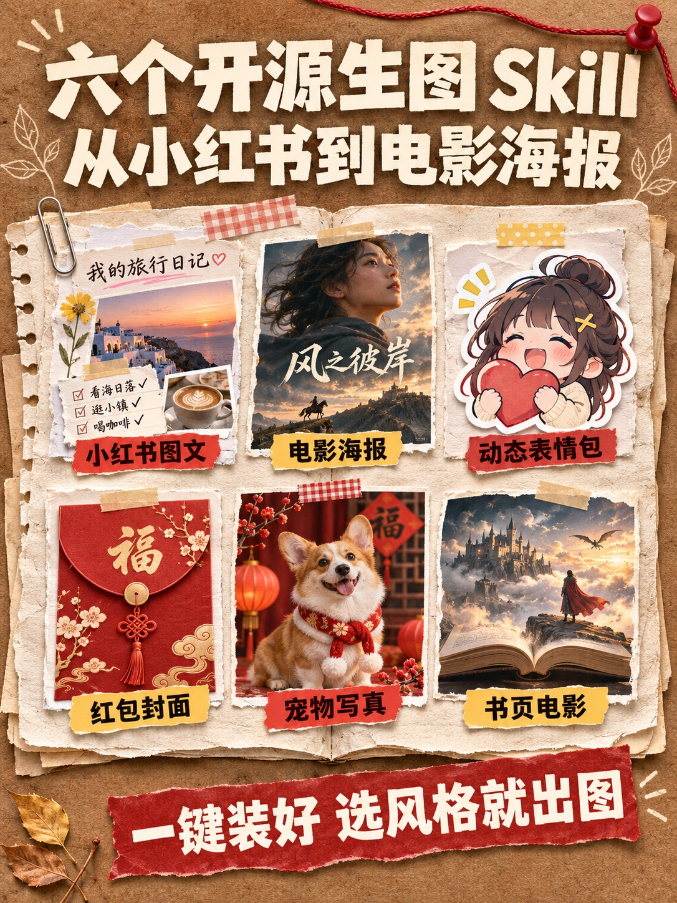
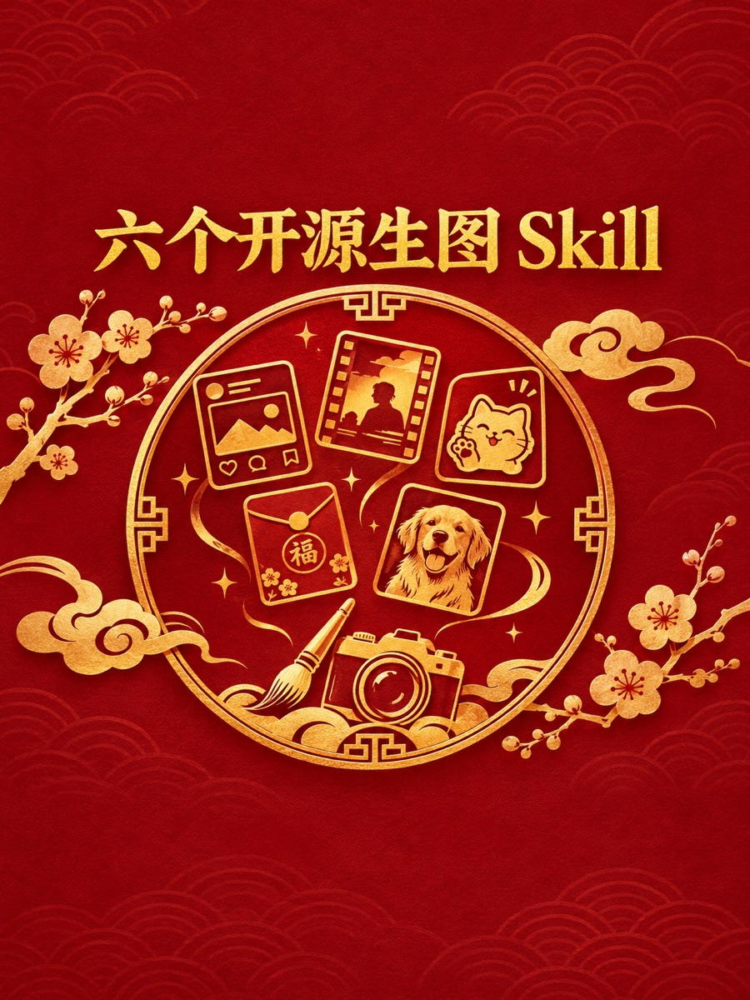
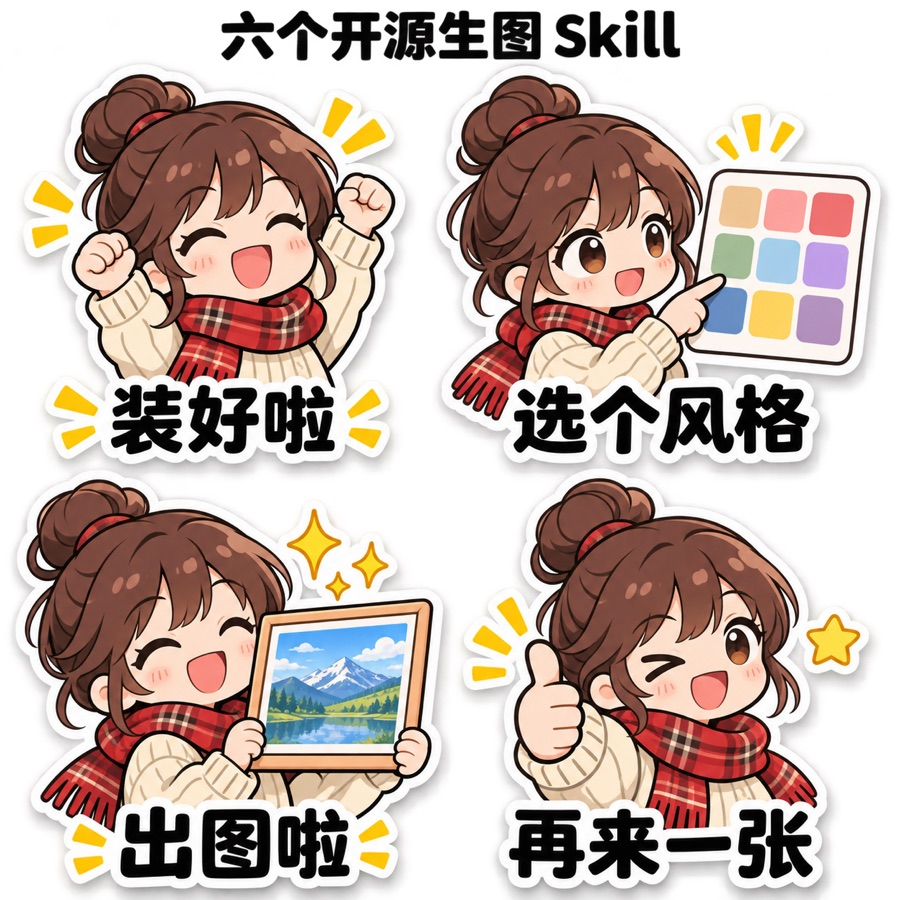

# 六个开源生图 Skill，从小红书到电影海报



完整说明和更多效果图：[cwyz.com 上的 Skill 页面](https://cwyz.com/zh/skills/vane-gpt-image-skills)

把这个 Skill 交给你的 AI Agent，它会一次装好六个 GPT Image 2.6 生图 Skill。之后你只要说"用手帐拼贴风把这段话做成小红书图文"，它就照着现成的风格和版式出图。

| Skill | 能做什么 |
| --- | --- |
| `vane-xhs-design` | 小红书封面和正文图：手帐拼贴风、极简产品风，先看九宫格再逐张出图 |
| `vane-cinematic-poster` | 电影级海报，36 种构图版式，中英文都行 |
| `vane-portrait-gif-stickers` | 照片变成 12 种画风的动态表情包，默认一套 16 张 |
| `vane-book-cinema` | 把一本书变成电影感海报 |
| `wechat-red-packet-cover` | 微信红包封面，36 种风格 |
| `vane-pet-new-year-portrait` | 宠物新年写真 |

## 怎么装

把下面这句话发给你的 AI Agent：

```text
请安装这个 skill，然后用它帮我把六个生图 Skill 都装好：
https://github.com/clinchcc/gpt-image-skills-pack
```

也可以自己装：

```bash
git clone https://github.com/VaneAi888/vane-gpt-image-skills.git
cd vane-gpt-image-skills
python3 scripts/install_skills.py --all
```

装完开一个新对话，用 `$Skill名` 调用，比如 `$vane-xhs-design 手帐拼贴风，把下面的文字做成一套小红书图文`。

## 需要准备

- 有生图能力的 AI Agent（能调用 GPT Image 2.6 或同类模型）。没有生图工具时，它只能给出提示词和版式说明。
- Python 3 和 Git。做 GIF 表情包另外要 Pillow 和 FFmpeg。
- 不需要 API Key。

## 效果示例

下面五张是用这几个 Skill 的风格做的同一个主题，都由 AI 生成：

| 电影海报 | 书页电影 | 红包封面 |
| :---: | :---: | :---: |
|  |  |  |
| **宠物写真** | **表情包（静态预览）** | |
|  |  | |

## 来源和许可

六个生图 Skill 来自 [VaneAi888/vane-gpt-image-skills](https://github.com/VaneAi888/vane-gpt-image-skills)（MIT）。本仓库只是一份安装和使用说明，同样用 MIT 许可。中文介绍见 [cwyz.com/zh/skills/vane-gpt-image-skills](https://cwyz.com/zh/skills/vane-gpt-image-skills)。示例图里的片名、人物和宠物都是 AI 生成的，和真实作品无关。

## English

An installer skill for your AI agent: it sets up six open-source GPT Image 2.6 skills by VaneAi888 (Xiaohongshu posts, cinematic posters, animated stickers, WeChat red packet covers, pet New Year portraits, book-to-film posters). Give your agent `https://github.com/clinchcc/gpt-image-skills-pack` and ask it to install the skill. Needs an agent with an image-generation tool. MIT licence. Full guide: [cwyz.com/skills/vane-gpt-image-skills-en](https://cwyz.com/skills/vane-gpt-image-skills-en).
